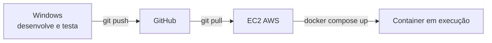

# Django API com Docker + SQLite (roteiro inicial)

## Objetivo

Criar a API Django e rodá-la em um container Docker usando SQLite. Este é o ponto de partida: o roteiro seguinte ([djangopg.md](./djangopg.md)) evolui o mesmo projeto para PostgreSQL.

Resultado: endpoint `http://localhost:8000/api/tarefas/` funcionando em container, com dados persistidos em um volume.

## Pré-requisitos

- Windows: Python 3.12+, Docker Desktop (`docker compose version`) e Git
- Conta no GitHub e um repositório criado para o projeto
- Instância EC2 (Amazon Linux/Ubuntu) com Docker, Docker Compose e Git instalados, e acesso SSH

## Fluxo de trabalho

| Etapa | Onde | O que fazer |
|---|---|---|
| 1. Desenvolver | **Windows** | Partes 1 a 4: criar o projeto, escrever o código, subir o Docker e testar localmente |
| 2. Versionar | **Windows → GitHub** | Parte 5: `git commit` e `git push` |
| 3. Sincronizar | **GitHub → EC2** | Parte 6: `git clone`/`git pull` na EC2 |
| 4. Deploy | **EC2 (Docker)** | Parte 7: `docker compose up -d --build` e teste pelo IP público |



Regra: o código é alterado **somente no Windows**. A EC2 apenas recebe as mudanças via Git e executa o deploy.

---

## Parte 1 - Criar o projeto (Windows)

```bash
mkdir minha-api && cd minha-api
python -m venv .venv
# Windows: .venv\Scripts\activate   |  Linux/Mac: source .venv/bin/activate
pip install django djangorestframework gunicorn
pip freeze > requirements.txt
django-admin startproject config .
python manage.py startapp tarefas
```

No Windows, salve o conteúdo abaixo como `criar-projeto.ps1` na pasta onde deseja criar o projeto e execute-o no PowerShell. O script usa diretamente o Python do ambiente virtual, sem precisar ativá-lo:

```powershell
$ErrorActionPreference = "Stop"

New-Item -ItemType Directory -Force -Path "minha-api" | Out-Null
Set-Location "minha-api"

python -m venv .venv
$python = ".\.venv\Scripts\python.exe"
& $python -m pip install django djangorestframework gunicorn
& $python -m pip freeze | Set-Content -Encoding ascii requirements.txt
& ".\.venv\Scripts\django-admin.exe" startproject config .
& $python manage.py startapp tarefas
```

Execute com ` .\criar-projeto.ps1` (sem o espaço inicial). Se a política de execução bloquear o script, use `powershell -ExecutionPolicy Bypass -File .\criar-projeto.ps1`.


## Parte 2 - Código da API (Windows)

### `config/settings.py`

Registre os apps, aceite requisições externas e deixe o caminho do SQLite configurável (isso facilita a troca por Postgres depois):

```python
import os

ALLOWED_HOSTS = os.environ.get("DJANGO_ALLOWED_HOSTS", "*").split(",")

INSTALLED_APPS = [
    # ... apps padrão ...
    "rest_framework",
    "tarefas",
]

DATABASES = {
    "default": {
        "ENGINE": "django.db.backends.sqlite3",
        "NAME": os.environ.get("SQLITE_PATH", BASE_DIR / "db.sqlite3"),
    }
}
```

### `tarefas/models.py`

```python
from django.db import models


class Tarefa(models.Model):
    titulo = models.CharField(max_length=200)
    concluida = models.BooleanField(default=False)
    criada_em = models.DateTimeField(auto_now_add=True)

    def __str__(self):
        return self.titulo
```

### `tarefas/serializers.py` (novo arquivo)

```python
from rest_framework import serializers
from .models import Tarefa


class TarefaSerializer(serializers.ModelSerializer):
    class Meta:
        model = Tarefa
        fields = "__all__"
```

### `tarefas/views.py`

```python
from rest_framework import viewsets
from .models import Tarefa
from .serializers import TarefaSerializer


class TarefaViewSet(viewsets.ModelViewSet):
    queryset = Tarefa.objects.all().order_by("-criada_em")
    serializer_class = TarefaSerializer
```

### `config/urls.py`

```python
from django.contrib import admin
from django.urls import include, path
from rest_framework.routers import DefaultRouter
from tarefas.views import TarefaViewSet

router = DefaultRouter()
router.register("tarefas", TarefaViewSet)

urlpatterns = [
    path("admin/", admin.site.urls),
    path("api/", include(router.urls)),
]
```

Gere a migração (será versionada no Git):

```bash
python manage.py makemigrations tarefas
```

---

## Parte 3 - Docker (Windows)

### O que é um Dockerfile?

Um Dockerfile é um arquivo de texto com instruções para construir uma imagem Docker. Ele descreve, em etapas, o ambiente e os arquivos necessários para executar a aplicação, como a imagem base, a instalação de dependências e o comando de inicialização. A imagem resultante pode ser usada para criar containers de forma reproduzível.

### `Dockerfile`

```dockerfile
FROM python:3.12-slim
ENV PYTHONDONTWRITEBYTECODE=1 PYTHONUNBUFFERED=1
WORKDIR /app
COPY requirements.txt .
RUN pip install --no-cache-dir -r requirements.txt
COPY . .
CMD ["sh", "-c", "python manage.py migrate --noinput && gunicorn config.wsgi:application --bind 0.0.0.0:8000"]
```

#### Explicação do Dockerfile

- `FROM python:3.12-slim`: inicia a imagem usando uma versão compacta do Python 3.12.
- `ENV PYTHONDONTWRITEBYTECODE=1 PYTHONUNBUFFERED=1`: evita a criação de arquivos `.pyc` e envia os logs do Python sem atraso.
- `WORKDIR /app`: define `/app` como diretório de trabalho dentro do container.
- `COPY requirements.txt .`: copia o arquivo de dependências para esse diretório.
- `RUN pip install --no-cache-dir -r requirements.txt`: instala as dependências sem manter o cache do pip na imagem.
- `COPY . .`: copia o restante do projeto para `/app`.
- `CMD [...]`: configura o comando executado ao iniciar o container. Ele aplica as migrações e, se isso terminar sem erro, inicia o Gunicorn na porta `8000`. `0.0.0.0` permite conexões de fora do container.

O `migrate` roda ao iniciar, criando o arquivo do SQLite se ele não existir.

### `.dockerignore`

```
.venv/
__pycache__/
*.pyc
db.sqlite3
.git/
```

### `.gitignore`

```
.venv/
__pycache__/
*.pyc
db.sqlite3
```

### `docker-compose.yml`

O arquivo `docker-compose.yml` descreve como iniciar e configurar os serviços de uma aplicação com o Docker Compose. Ele reúne em um só lugar informações como a forma de construir a imagem, as portas a publicar, as variáveis de ambiente e os volumes. Dessa forma, o ambiente pode ser iniciado de maneira consistente com um comando, como `docker compose up`.


```yaml
services:
  web:
    build: .
    ports:
      - "8000:8000"
    environment:
      SQLITE_PATH: /data/db.sqlite3
    volumes:
      - sqlitedata:/data

volumes:
  sqlitedata:
```

- `services`: declara os serviços da aplicação; aqui, o serviço `web` executa a API.
- `build: .`: constrói a imagem usando o Dockerfile do diretório atual.
- `ports`: permite acessar a porta `8000` do container pela porta `8000` do computador.
- `environment`: informa à aplicação o caminho do banco SQLite.
- `volumes`: monta o volume persistente `sqlitedata` no diretório `/data` do container.

O volume `sqlitedata` guarda o arquivo `.sqlite3` fora do container; sem ele, os dados seriam perdidos a cada recriação.

---

## Parte 4 - Executar e testar localmente (Windows)

Execute no PowerShell, na pasta `minha-api`, com o Docker Desktop em execução. Só avance para a Parte 5 depois que a API responder corretamente aqui.

```bash

docker compose up -d --build
docker compose logs -f web
```

`docker compose logs -f web` exibe os logs do serviço `web` e continua acompanhando novas mensagens (`-f`). Pressione `Ctrl+C` para parar de acompanhar os logs; o container continuará em execução.

`docker compose up -d --build` constrói ou atualiza a imagem da aplicação e inicia os serviços em segundo plano (`-d`).

```bash
curl http://localhost:8000/api/tarefas/
curl -X POST http://localhost:8000/api/tarefas/ -H "Content-Type: application/json" -d '{"titulo":"Estudar Docker"}'
curl http://localhost:8000/api/tarefas/
```

No PowerShell, use `curl.exe` ou `Invoke-RestMethod`. Também é possível abrir `http://localhost:8000/api/tarefas/` no navegador.

### Testar a persistência

```bash
docker compose down
docker compose up -d
curl http://localhost:8000/api/tarefas/
```

A tarefa criada deve continuar na lista.

### (Opcional) Admin

```bash
docker compose exec web python manage.py createsuperuser
```

Acesse `http://localhost:8000/admin/`. Sem arquivos estáticos configurados, o admin aparece sem estilo; isso é esperado neste roteiro inicial.

Ao terminar os testes, pare o ambiente local com `docker compose down`.

---

## Parte 5 - Sincronizar com o GitHub (Windows → GitHub)

No PowerShell, na pasta `minha-api`:

```powershell
git init
git add .
git commit -m "API Django com Docker e SQLite"
git branch -M main
git remote add origin https://github.com/<usuario>/<repositorio>.git
git push -u origin main
```

Confira no GitHub que `Dockerfile`, `docker-compose.yml`, `requirements.txt`, `manage.py` e `tarefas/migrations/` estão presentes e que `.venv/` e `db.sqlite3` não foram enviados.

Em alterações futuras, repita apenas:

```powershell
git add .
git commit -m "descrição da mudança"
git push
```

---

## Parte 6 - Sincronizar com a EC2 (GitHub → EC2)

No Security Group da EC2, libere a porta de entrada `22` (SSH) e a `8000` (API, TCP). Conecte-se pelo terminal do Vscode:

ou Terminal do Windows
```powershell
ssh -i caminho\chave.pem ec2-user@<IP_PUBLICO_EC2>
```

Na **EC2** (ec2-user), obtenha o código:

```bash
# primeira vez
git clone https://github.com/<usuario>/<repositorio>.git
cd <repositorio>

# próximas vezes
cd <repositorio>
git pull
```

Se o repositório for privado, use um Personal Access Token ou uma deploy key.

---

## Parte 7 - Deploy com Docker (EC2)

Execute na **EC2**, na pasta do projeto:

```bash
docker compose up -d --build
docker compose ps
docker compose logs -f web
```

Teste de qualquer máquina (inclusive o Windows):

```powershell
curl.exe http://<IP_PUBLICO_EC2>:8000/api/tarefas/
```

Para restringir o acesso, defina `DJANGO_ALLOWED_HOSTS` no Compose (ex.: `<IP_PUBLICO_EC2>`) em vez de usar `*`.

### Ciclo de atualização

1. **Windows**: altere o código, teste com `docker compose up -d --build` e execute `git push`.
2. **EC2**: execute `git pull`.
3. **EC2**: execute `docker compose up -d --build`.

Os dados ficam no volume `sqlitedata` da EC2, separado do volume local do Windows; não use `down -v` na EC2 se quiser preservá-los.

---

## Comandos úteis

| Ação | Comando |
|---|---|
| Ver containers | `docker compose ps` |
| Logs | `docker compose logs -f web` |
| Shell do Django | `docker compose exec web python manage.py shell` |
| Parar | `docker compose down` |
| Parar e **apagar dados** | `docker compose down -v` |
| Rebuild após mudar código | `docker compose up -d --build` |

## Problemas comuns

- **`DisallowedHost`**: defina `DJANGO_ALLOWED_HOSTS` ou mantenha o padrão `*` (somente em desenvolvimento).
- **`no such table`**: faltou a migração; confira se `tarefas/migrations/` existe e rebuild a imagem.
- **Dados sumiram**: provavelmente foi usado `docker compose down -v`, que remove o volume.
- **Porta 8000 ocupada**: troque para `"8001:8000"` no Compose.

## Limitações do SQLite (por que evoluir)

- Um único arquivo: não suporta bem várias instâncias/containers escrevendo ao mesmo tempo.
- Menos recursos que o PostgreSQL (tipos, extensões, concorrência).
- Backup e escala dependem de copiar o arquivo.

## Próximo passo

Siga [djangopg.md](./djangopg.md) e [preparopg.md](./preparopg.md) para trocar o SQLite pelo PostgreSQL em container. A mudança se resume a: ajustar `DATABASES` em `settings.py` para ler as variáveis `POSTGRES_*`, adicionar `psycopg[binary]` ao `requirements.txt` e incluir o serviço `db` no Compose.
