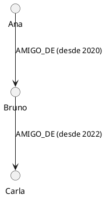

#  Apache AGE e Grafos
## **Do Zero ao Primeiro Grafo em 30 minutos**

## **O que você vai aprender**

Ao final deste roteiro, você será capaz de:
1. Explicar o que é um grafo e quando usá-lo
2. Criar seu primeiro grafo no Apache AGE
3. Escrever queries básicas em Cypher
4. Entender a diferença entre grafos e tabelas SQL

## **1. O que é um Grafo?**

Um **grafo** é uma estrutura de dados feita de:
- **Nós** (vértices): as "coisas" — pessoas, cidades, produtos
- **Arestas** (relacionamentos): as "conexões" entre elas

### Analogia simples:
```
Pense em um mapa de metrô:
- Estações = NÓS
- Linhas que conectam estações = ARESTAS
- Distância entre estações = PROPRIEDADE da aresta
```

### Visualização:
```
    (São Paulo) ──430km──▶ (Rio de Janeiro)
        │                        │
     410km                    440km
        │                        │
        ▼                        ▼
    (Curitiba) ◀──590km── (Belo Horizonte)
```

---

## **2. Por que Grafos? (A diferença crucial)**

### Problema clássico em SQL:
*"Encontre todos os caminhos entre São Paulo e Curitiba passando por no máximo 3 cidades"*

**Em SQL:** Você precisaria de múltiplos JOINs, UNIONs, ou procedures recursivas. Complexo e lento.

**Em Cypher (grafo):**
```cypher
MATCH path = (sp:City {name: 'São Paulo'})-[:ROAD*1..3]->(cur:City {name: 'Curitiba'})
RETURN path
```
**Pronto.** Uma linha.

### Quando usar cada um?

| Situação | Use |
|----------|-----|
| Dados com estrutura fixa, transações financeiras | **SQL** |
| Dados semiestruturados, catálogos variáveis | **Documento (MongoDB)** |
| Relacionamentos complexos, rotas, redes sociais | **Grafo (AGE)** |

---

## **3. Apache AGE em 1 minuto**

**Apache AGE** = Extensão do PostgreSQL que adiciona suporte a grafos.

**Vantagens:**
- Usa a mesma sintaxe Cypher do Neo4j (padrão da indústria)
- Roda **dentro** do PostgreSQL (ACID, backups, ferramentas conhecidas)
- Você pode misturar SQL + Cypher na mesma query

**Instalação:** 

#### comando alternativo (sem docker-compose):

```bash
docker run -d --name swifttrack_age -e POSTGRES_DB=swifttrack_graph -e POSTGRES_USER=admin -e POSTGRES_PASSWORD=secret123 -p 5433:5432 apache/age:latest
```

## **4. Mão na Massa — Seu Primeiro Grafo**

### 4.1 Conecte-se ao banco

```bash
docker exec -it swifttrack_age psql -U admin -d swifttrack_graph
```

### 4.2 Habilite o AGE

```sql
CREATE EXTENSION IF NOT EXISTS age;
LOAD 'age';
SET search_path = ag_catalog, "$user", public;
```

### 4.3 Crie seu primeiro grafo

```sql
SELECT create_graph('meu_primeiro_grafo');
```

**Parabéns!** Você tem um grafo vazio.

---

## **5. Sintaxe Cypher — O Essencial**

Cypher é a linguagem de consulta de grafos. Pense nela como o "SQL dos grafos".

### 5.1 CREATE — Criar nós

```sql
SELECT * FROM cypher('meu_primeiro_grafo', $$
    CREATE (:Pessoa {nome: 'Ana', idade: 30})
$$) AS (result agtype);
```

**Anatomia:**
- `:Pessoa` → **rótulo** (tipo do nó)
- `{nome: 'Ana', idade: 30}` → **propriedades** (dados do nó)

### 5.2 CREATE — Criar relacionamento

```sql
SELECT * FROM cypher('meu_primeiro_grafo', $$
    MATCH (a:Pessoa {nome: 'Ana'}), (b:Pessoa {nome: 'Bruno'})
    CREATE (a)-[:AMIGO_DE {desde: 2020}]->(b)
$$) AS (result agtype);
```

**Anatomia:**
- `[:AMIGO_DE]` → tipo do relacionamento
- `{desde: 2020}` → propriedade da aresta
- `->` → direção (opcional)

---

## **6. Exemplo Completo — Rede Social Simples**

Vamos criar uma mini-rede social:




### Passo 1: Criar pessoas

```sql
SELECT * FROM cypher('meu_primeiro_grafo', $$
    CREATE (:Pessoa {nome: 'Ana', idade: 30, cidade: 'SP'})
$$) AS (r agtype);

SELECT * FROM cypher('meu_primeiro_grafo', $$
    CREATE (:Pessoa {nome: 'Bruno', idade: 28, cidade: 'SP'})
$$) AS (r agtype);

SELECT * FROM cypher('meu_primeiro_grafo', $$
    CREATE (:Pessoa {nome: 'Carla', idade: 35, cidade: 'RJ'})
$$) AS (r agtype);
```

### Passo 2: Criar relacionamentos

```sql
SELECT * FROM cypher('meu_primeiro_grafo', $$
    MATCH (a:Pessoa {nome: 'Ana'}), (b:Pessoa {nome: 'Bruno'})
    CREATE (a)-[:AMIGO_DE {desde: 2020}]->(b)
$$) AS (r agtype);

SELECT * FROM cypher('meu_primeiro_grafo', $$
    MATCH (a:Pessoa {nome: 'Bruno'}), (b:Pessoa {nome: 'Carla'})
    CREATE (a)-[:AMIGO_DE {desde: 2022}]->(b)
$$) AS (r agtype);
```

### Passo 3: Consultar — "Quem são os amigos de Bruno?"

```sql
SELECT * FROM cypher('meu_primeiro_grafo', $$
    MATCH (bruno:Pessoa {nome: 'Bruno'})-[:AMIGO_DE]-(amigo)
    RETURN amigo.nome, amigo.idade, amigo.cidade
$$) AS (nome agtype, idade agtype, cidade agtype);
```

**Resultado:**
| nome | idade | cidade |
|------|-------|--------|
| Ana | 30 | SP |
| Carla | 35 | RJ |

### Passo 4: Consultar — "Amigos de amigos de Ana" (2 hops)

```sql
SELECT * FROM cypher('meu_primeiro_grafo', $$
    MATCH (ana:Pessoa {nome: 'Ana'})-[:AMIGO_DE*2]-(fof)
    WHERE fof.nome <> 'Ana'
    RETURN DISTINCT fof.nome
$$) AS (nome agtype);
```

**Resultado:** Carla (amiga de Bruno, que é amigo de Ana)

---

## **7. As 5 Queries Essenciais que Você Precisa Saber**

### 🔹 1. Listar todos os nós
```cypher
select * FROM cypher('meu_primeiro_grafo', $$
    MATCH (n) RETURN labels(n), count(*)
$$) AS (labels agtype, count agtype);
```

### 🔹 2. Buscar nó por propriedade
```cypher
select * FROM cypher('meu_primeiro_grafo', $$
    MATCH (p:Pessoa {nome: 'Ana'}) RETURN p
$$) AS (p agtype);
```

### 🔹 3. Filtrar com WHERE
```cypher
select * FROM cypher('meu_primeiro_grafo', $$
    MATCH (p:Pessoa) 
    WHERE p.idade > 28 
    RETURN p.nome, p.idade
$$) AS (nome agtype, idade agtype);
```

### 🔹 4. Contar relacionamentos
```cypher
select * FROM cypher('meu_primeiro_grafo', $$
    MATCH (p:Pessoa)-[r:AMIGO_DE]->()
    RETURN p.nome, count(r) AS num_amigos
$$) AS (nome agtype, num_amigos agtype);
```

### 🔹 5. Caminho mais curto
```cypher
MATCH path = shortestPath(
    (a:Pessoa {nome: 'Ana'})-[*]-(b:Pessoa {nome: 'Carla'})
)
RETURN path
```

---

## **8. Padrões Visuais do Cypher**

A sintaxe do Cypher é **icônica** — ela desenha o grafo:

| Símbolo | Significado |
|---------|-------------|
| `(n)` | Nó qualquer |
| `(:Pessoa)` | Nó com rótulo "Pessoa" |
| `({nome: 'Ana'})` | Nó com propriedade |
| `()-[]->()` | Relacionamento direcionado |
| `()-[:AMIGO_DE]->()` | Relacionamento de tipo específico |
| `()-[*1..3]->()` | Entre 1 e 3 hops |

**Dica:** Se você consegue desenhar o que quer, consegue escrever a query!

---

## **9. Exercícios de Fixação**

### Nível 1 — Básico
1. Crie 3 cidades: São Paulo, Rio de Janeiro, Curitiba
2. Crie rotas entre elas com distância em km
3. Liste todas as cidades

### Nível 2 — Intermediário
4. Encontre a rota mais curta entre SP e Curitiba
5. Calcule a distância total de cada rota
6. Liste cidades com mais de 1 conexão

### Nível 3 — Avançado
7. Encontre todos os caminhos possíveis entre SP e Curitiba (máx. 3 hops)
8. Ordene por custo (distância × R$2/km)
9. Retorne o caminho mais barato

---

## **10. Comandos Úteis de Sobrevivência**

```sql
-- Ver todos os grafos
SELECT * FROM ag_graph;

-- Ver todos os nós de um grafo
SELECT * FROM cypher('meu_primeiro_grafo', $$
    MATCH (n) RETURN n
$$) AS (n agtype);

-- Apagar o grafo inteiro (CUIDADO!)
SELECT drop_graph('meu_primeiro_grafo', true);

-- Sair do psql
\q
```

---

## ** Resumo em 1 Parágrafo**

> **Grafos** são estruturas de nós e relacionamentos, ideais para dados altamente conectados. **Apache AGE** traz essa capacidade para dentro do PostgreSQL, usando a linguagem **Cypher** (padrão da indústria). A sintaxe é visual: você "desenha" a query com parênteses para nós e setas para relacionamentos. Em 1 linha de Cypher, você faz o que levaria dezenas de JOINs em SQL.

---

## ** Próximos Passos**

Após dominar este roteiro, avance para:
1. **Propriedades em arestas** (pesos, datas, status)
2. **Agregações** (COUNT, SUM, AVG em grafos)
3. **Algoritmos** (caminho mais curto, PageRank)
4. **Integração SQL + Cypher** (o poder real do AGE)
